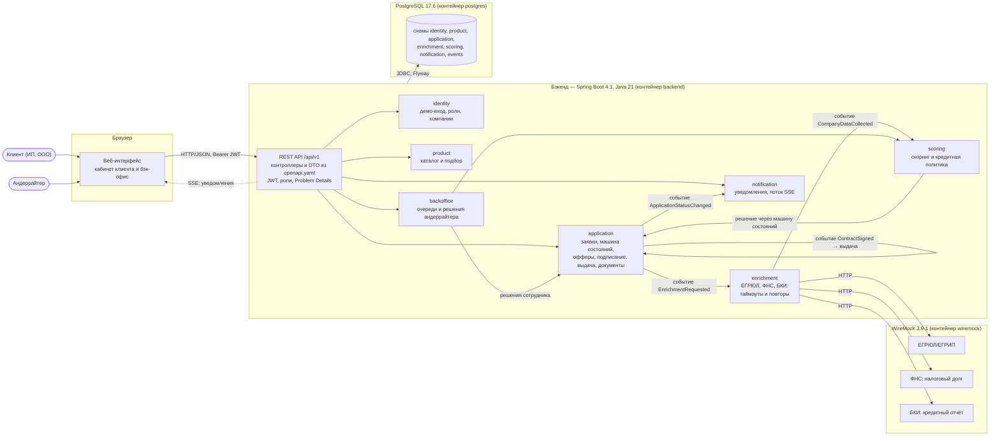
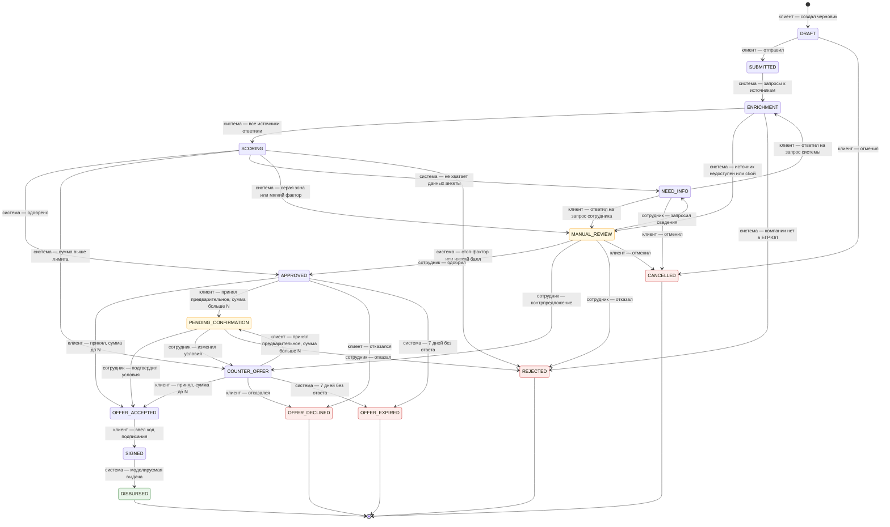

# Диаграммы: архитектура, состояния заявки, модель данных

Диаграммы сверены с кодом: зависимости модулей — по импортам между пакетами `ru.creditconveyor.*`, переходы — класс `StatusTransitions` модуля `application`, таблицы — миграции Flyway V1–V18 (`backend/src/main/resources/db/migration`). Веб-интерфейс на схеме архитектуры показан одним блоком.

## Архитектура

Один веб-интерфейс с двумя ролями, бэкенд — модульный монолит (Spring Modulith), одна PostgreSQL со своей схемой на модуль, внешние источники — моки WireMock. Всё поднимается `docker compose up --build`.

Связи между модулями:

| Модуль | Обращается к (через публичные классы корневого пакета) | События |
|---|---|---|
| `identity` | — | — |
| `product` | `identity` (возраст бизнеса в подборе) | — |
| `application` | `identity` (доступ к компаниям), `product` (условия продукта при отправке) | публикует `EnrichmentRequested`, `ContractSigned`, `ApplicationStatusChanged`; слушает `ContractSigned` (выдача) |
| `enrichment` | `application` (переход в `ENRICHMENT`), `identity` (ИНН компании) | слушает `EnrichmentRequested`, публикует `CompanyDataCollected` |
| `scoring` | `application` (данные заявки, переходы), `enrichment`, `product` (каталог) | слушает `CompanyDataCollected` |
| `notification` | `application`, `identity` | слушает `ApplicationStatusChanged` |
| `backoffice` | `application`, `enrichment`, `identity`, `product`, `scoring` | — |

События доставляются после фиксации транзакции и хранятся в журнале `events.event_publication` — недоставленное событие повторяется после перезапуска. Границы модулей проверяет тест `ModularityTests`.

## Состояния заявки

Все 16 статусов и 32 разрешённых перехода (`StatusTransitions`). Подпись: кто переводит — **клиент**, **система** или **сотрудник** (андеррайтер). Любой другой переход — `409`.

N = 1 000 000 ₽ (`app.scoring.preliminary-above`); предложение сотрудника (из `MANUAL_REVIEW`) не предварительное. Цвет: зелёный — выдача, красный — прочие финальные статусы, жёлтый — ждут сотрудника. Каждый переход пишется в `application.status_history` (из какого, в какой, кто, когда, комментарий).

| Кто | Переходов | Как вызывается |
|---|---|---|
| клиент | 13 | API заявок: `submit`, `cancel`, ответ на запрос, `offer/accept`, `offer/decline`, `signing/confirm` |
| система | 12 | обработчики событий конвейера, истечение оффера (при чтении и фоновой задачей), выдача после подписания |
| сотрудник | 7 | бэк-офис: `decision`, `info-requests` |

## Модель данных

Таблицы по схемам модулей (миграции V1–V18, служебная таблица Flyway не показана). Сплошная линия — внешний ключ в базе; пунктир — ссылка по id между схемами разных модулей: внешних ключей между модулями намеренно нет, чтобы модули оставались независимыми. Деньги — `NUMERIC(19,2)`, время — `TIMESTAMPTZ`, массивы кодов — `VARCHAR[]`.

```mermaid
erDiagram
    identity_users {
        uuid id PK
        varchar login UK
        varchar full_name
        varchar role "CLIENT, UNDERWRITER"
    }
    identity_companies {
        uuid id PK
        varchar inn UK
        varchar ogrn UK
        varchar business_type "IP, LLC"
        varchar name
        date registration_date
        varchar status "ACTIVE, LIQUIDATING, LIQUIDATED"
        varchar okved
        varchar region
    }
    identity_user_companies {
        uuid user_id PK, FK
        uuid company_id PK, FK
        varchar demo_scenario
        int sort_order
    }

    product_credit_products {
        varchar code PK
        varchar name
        numeric min_amount
        numeric max_amount
        varchar term_kind "LOAN, TRANCHE"
        varchar term_unit "MONTHS, DAYS"
        int min_term
        int max_term
        int max_term_with_subscription
        int agreement_term_months
        boolean auto_renewal
        varchar rate_unit "PERCENT_PER_YEAR, PERCENT_PER_DAY"
        numeric base_rate
        numeric rate_with_subscription
        numeric subscription_fee_percent
        varchar_array funding_modes
        varchar_array repayment_types
        int min_business_age_months
        boolean active
    }

    application_applications {
        uuid id PK
        varchar number UK "CR-2026-000123"
        uuid company_id "identity.companies"
        uuid applicant_id "identity.users"
        varchar product_code "product.credit_products"
        varchar purpose
        numeric requested_amount
        int term
        varchar term_unit
        varchar funding_mode
        varchar repayment_type
        numeric annual_revenue
        numeric annual_expenses
        numeric bank_monthly_turnover
        numeric monthly_debt_payment
        boolean subscription
        varchar status "16 статусов"
        int processing_round
        bigint version "оптимистичная блокировка"
        timestamptz status_changed_at
        timestamptz created_at
        timestamptz submitted_at
    }
    application_status_history {
        bigint id PK
        uuid application_id FK
        varchar from_status
        varchar to_status
        varchar actor_type "CLIENT, SYSTEM, EMPLOYEE"
        uuid actor_id
        text comment
        timestamptz created_at
    }
    application_application_reasons {
        uuid application_id PK, FK
        int position PK
        varchar code
        text message
        text advice
    }
    application_offers {
        uuid id PK
        uuid application_id FK
        varchar product_code
        numeric amount
        int term
        varchar term_unit
        varchar term_kind
        numeric rate
        varchar rate_unit
        numeric monthly_payment
        boolean subscription
        numeric subscription_fee
        boolean preliminary
        varchar status "ACTIVE, ACCEPTED, DECLINED, EXPIRED, SUPERSEDED"
        timestamptz expires_at
    }
    application_info_requests {
        uuid id PK
        uuid application_id FK
        varchar message
        varchar_array requested_fields
        varchar_array requested_documents
        varchar created_by "SYSTEM, EMPLOYEE"
        varchar status "OPEN, ANSWERED"
        varchar response
    }
    application_signing_codes {
        uuid id PK
        uuid application_id FK
        varchar code_hash "SHA-256"
        int attempts
        varchar status "ACTIVE, USED, SUPERSEDED, BLOCKED"
        timestamptz expires_at
        bigint version
    }
    application_documents {
        uuid id PK
        uuid application_id FK
        uuid info_request_id FK
        varchar document_type
        varchar file_name
        varchar mime_type
        bigint size_bytes
        varchar sha256
        uuid uploaded_by
    }
    application_document_contents {
        uuid document_id PK, FK
        bytea content
    }

    enrichment_enrichments {
        uuid id PK
        uuid application_id "application.applications"
        varchar inn
        boolean company_found
        varchar company_status
        date registration_date
        numeric tax_debt_amount
        int active_credits_count
        numeric total_debt_amount
        int max_overdue_days_12m
        timestamptz created_at
    }
    enrichment_source_results {
        uuid id PK
        uuid enrichment_id FK
        varchar source "EGRUL, FNS, BKI"
        varchar status "OK, NOT_FOUND, ERROR, TIMEOUT"
        int attempts
        int http_status
        jsonb raw "ответ источника как есть"
    }

    scoring_scoring_results {
        uuid id PK
        uuid application_id "application.applications"
        int score "0-100"
        varchar grade "A-E"
        timestamptz created_at
    }
    scoring_scoring_factors {
        uuid scoring_result_id PK, FK
        int position PK
        varchar factor
        varchar input_value
        int points
        int max_points
        varchar explanation
    }
    scoring_decisions {
        uuid id PK
        uuid application_id "application.applications"
        uuid enrichment_id "enrichment.enrichments"
        uuid scoring_result_id FK
        varchar outcome "APPROVE, COUNTER_OFFER, NEED_INFO, MANUAL_REVIEW, REJECT"
        varchar_array reason_codes
        varchar_array missing_fields
        numeric limit_amount
        numeric offered_amount
        boolean preliminary
        varchar decided_by "SYSTEM, EMPLOYEE"
        uuid employee_id "identity.users"
        varchar comment
    }

    notification_notifications {
        uuid id PK
        uuid event_id UK "повторная доставка не дублирует"
        uuid recipient_id "identity.users"
        uuid application_id "application.applications"
        varchar type
        varchar title
        text body
        timestamptz created_at
        timestamptz read_at
    }

    events_event_publication {
        uuid id PK
        text listener_id
        text event_type
        text serialized_event
        timestamptz publication_date
        timestamptz completion_date
    }

    identity_users ||--o{ identity_user_companies : "доступ к компаниям"
    identity_companies ||--o{ identity_user_companies : "привязка к клиенту"
    identity_companies ||..o{ application_applications : "company_id"
    identity_users ||..o{ application_applications : "applicant_id"
    product_credit_products ||..o{ application_applications : "product_code"

    application_applications ||--o{ application_status_history : "история"
    application_applications ||--o{ application_application_reasons : "причины решения"
    application_applications ||--o{ application_offers : "предложения"
    application_applications ||--o{ application_info_requests : "запросы сведений"
    application_applications ||--o{ application_signing_codes : "коды подписания"
    application_applications ||--o{ application_documents : "документы"
    application_info_requests |o--o{ application_documents : "приложены к ответу"
    application_documents ||--|| application_document_contents : "содержимое"

    application_applications ||..o{ enrichment_enrichments : "application_id"
    enrichment_enrichments ||--|{ enrichment_source_results : "ответы источников"

    application_applications ||..o{ scoring_scoring_results : "application_id"
    scoring_scoring_results ||--|{ scoring_scoring_factors : "разбивка балла"
    application_applications ||..o{ scoring_decisions : "application_id"
    scoring_scoring_results |o--o{ scoring_decisions : "балл решения"
    enrichment_enrichments |o..o{ scoring_decisions : "enrichment_id"

    identity_users ||..o{ notification_notifications : "recipient_id"
    application_applications |o..o{ notification_notifications : "application_id"
```

Ограничения, которых не видно на схеме:

| Таблица | Ограничение |
|---|---|
| `application.applications` | `status` — CHECK по 16 статусам; `term` и `term_unit` заполнены вместе; `version` — оптимистичная блокировка (`@Version`) |
| `application.info_requests` | не больше одного открытого запроса на заявку (частичный уникальный индекс) |
| `application.signing_codes` | не больше одного действующего кода на заявку; хранится хеш, а не код |
| `application.offers` | у заявки одно действующее предложение, прежнее → `SUPERSEDED` (в коде) |
| `scoring.decisions` | решение системы — с `enrichment_id` и без `employee_id`, решение сотрудника — с `employee_id` |
| `identity.companies` | ИНН и ОГРН по длине соответствуют типу (ООО — 10 и 13, ИП — 12 и 15) |
| `notification.notifications` | `event_id` уникален — повторно доставленное событие не создаёт второе уведомление |
